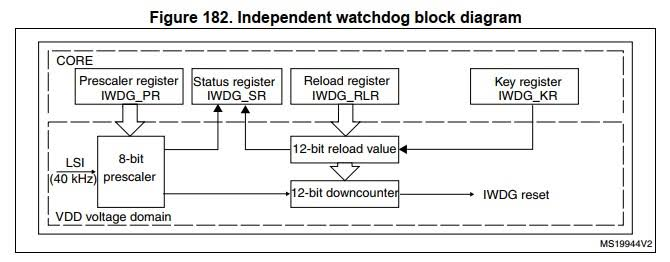

# TECHNICAL REPORT: INDEPENDENT WATCHDOG (IWDG) MODULE IMPLEMENTATION

---

## 1. Background, Objectives & Hardware Principles

### 1.1. Practical Background & Objectives
In embedded systems and industrial IoT devices operating 24/7 (such as remote telemetry stations or unattended equipment), software can freeze due to memory faults, inter-thread deadlocks, or electromagnetic interference (EMI) corrupting instruction pointers. When this occurs, the device enters a state of "clinical death".
* **Task Objective:** Implement a complete Independent Watchdog module (`wdt_token`) on Zephyr RTOS to automatically detect system hangs, trigger a hardware reset, and recover MCU operation on supported STM32 microcontrollers.

### 1.2. STM32 Independent Watchdog (IWDG) Operating Principle
Unlike the Window Watchdog (WWDG) which depends on the main system clock, the STM32 IWDG operates with standalone hardware characteristics:
1. **Independent Clock Source (LSI):** Driven by an internal low-speed RC oscillator (LSI ~32 kHz on STM32F4, ~40 kHz on STM32F1), operating entirely isolated from the main crystal oscillator (HSE/HSI). Even if the CPU core hangs or the main system clock fails, the IWDG counter continues to run.
2. **12-bit Down-counter Mechanism:**
   - **Normal Operation:** The CPU periodically executes a "feed/kick" command ➔ The reload value is refreshed into the counter ➔ The counter never counts down to `0`.
   - **Hang Condition:** When the CPU hangs ➔ Feeding halts ➔ The counter counts down to `0` ➔ IWDG hardware generates a hardware reset pulse via the NRST line to reboot the microcontroller.
3. **Safety Guarantee (Non-stoppable):** Once enabled by writing the key code `0xCCCC` to the key register, the IWDG cannot be stopped by any software instruction except via a System Reset.



---

## 2. Layered Architecture in Zephyr RTOS

The system follows a clean, decoupled 4-layer architecture:

```text
+-------------------------------------------------------------------+
| 1. APPLICATION LAYER: sample_app/src/main.c                       |
|    - Coordinates initialization, periodic feeding, and hang test  |
+-------------------------------------------------------------------+
                                  │
                                  ▼
+-------------------------------------------------------------------+
| 2. INDEPENDENT MODULE LAYER: include/wdt_token.h & src/wdt_token.c|
|    - Provides hardware-agnostic API: init, feed, force_hang       |
|    - Automatically discovers DeviceTree nodes via compatible/alias|
+-------------------------------------------------------------------+
                                  │
                                  ▼
+-------------------------------------------------------------------+
| 3. ZEPHYR SUBSYSTEM & DRIVER LAYER: drivers/watchdog/             |
|    - Kconfig (wdt.fragment.conf / prj.conf): CONFIG_WATCHDOG=y    |
|    - DeviceTree (app.overlay): Enables hardware &iwdg {status="okay"}|
+-------------------------------------------------------------------+
                                  │
                                  ▼
+-------------------------------------------------------------------+
| 4. HARDWARE LAYER: STM32F407 / STM32F103 IWDG Peripheral (LSI)    |
+-------------------------------------------------------------------+
```

---

## 3. System Configuration & Integration Notes

### 3.1. Configuration Parameters
- **Test Boards:** `black_f407ve` (STM32F407VET6) and `stm32f103_mini` (STM32F103RCT6).
- **Operating System:** Zephyr RTOS (v4.2.0).
- **Target Timeout (`timeout_ms`):** `4000 ms` (Satisfies requirements: 3000 ms – 5000 ms).
- **Feed Interval (`WDT_FEED_INTERVAL_MS`):** `1000 ms` (Satisfies requirements: < Timeout / 2 = 2000 ms).
- **Test Flag:** `WDT_TOKEN_TEST=1` (Activates the forced-hang function `wdt_token_force_hang_for_test()`).

### 3.2. Kconfig & DeviceTree Configuration
- **`app.overlay`:** Mandatory to enable the IWDG peripheral node and define the alias:
  ```dts
  aliases {
      watchdog0 = &iwdg;
  };

  &iwdg {
      status = "okay";
  };
  ```
- **`wdt.fragment.conf`:**
  ```conf
  CONFIG_WATCHDOG=y
  CONFIG_IWDG_STM32_INITIAL_TIMEOUT=4000
  CONFIG_REBOOT=y
  CONFIG_GPIO=y
  CONFIG_PRINTK=y
  ```

### 3.3. Integration Call Points

#### • `wdt_token_init(uint32_t timeout_ms)`:
- **Call Location:** Called in `main()` immediately after fundamental hardware init (Clock, GPIO, Console UART/USB) and **before entering the main loop `while(1)`**.
- **Important Note:** Do not call too early if the system has long bootloader/pre-initialization routines to avoid premature resets before the main loop begins feeding.

#### • `wdt_token_feed()`:
Strategic feeding locations based on system execution flow:
1. **Immediately Post-Initialization (`Post-Init`):** Call once right after `wdt_token_init()` to fully reload the down-counter, giving maximum time margin for subsequent startup procedures.
2. **Inside Main Loop (`while(1)`):**
   - *At loop start:* Refreshes the counter immediately after waking up from sleep (`k_msleep()`).
   - *At loop end:* Acts as an execution **checkpoint**, confirming that all loop tasks completed safely and successfully from top to bottom before kicking the watchdog.
3. **Inside Long-Running / Blocking Wait Loops:**
   - Peripheral handshake: Waiting for USB CDC-ACM Terminal to open (`while (!dtr && wait_time < 25)`), DHCP lease, or Wi-Fi/LTE network attach.
   - Long hardware operations: SPI Flash sector erase/block write, OTA firmware flashing, or IMU sensor calibration.
4. **Between Heavy Computational Stages:** Interleave feed checkpoints during intensive cryptography calculations (TLS Handshake, RSA/ECC keygen, AES) or DSP algorithms.
5. **In Multi-threaded RTOS Architectures:** Employ a **Health Monitor Thread** pattern (only feeds when all worker threads report "alive" tokens/flags within the deadline).
6. **Important:** **NEVER call `wdt_token_feed()` inside hardware ISRs (Timer Interrupts / SysTick)**. If the main thread hangs or deadlocks, the hardware timer interrupt can keep firing and feeding the watchdog, completely blinding the watchdog to the system failure.

---

## 4. Test Results & Proof of Reset within Timeout Window

### 4.1. Verification Criteria for Timeout Window
- **Configured Timeout:** `timeout_ms = 4000 ms`.
- **Valid Reset Window:** $3000\text{ ms} \le \Delta T \le 5000\text{ ms}$ (per requirements, accounting for $\pm 10\%\sim 20\%$ LSI oscillator tolerance).

---

### 4.2. Summary of Hardware Test Results

| Criteria / Scenario | Board 1: `black_f407ve` | Board 2: `stm32f103_mini` | Specification Standard | Evaluation |
| :--- | :--- | :--- | :---: | :---: |
| **MCU Architecture** | STM32F407VET6 (Cortex-M4 @ 168MHz) | STM32F103RCT6 (Cortex-M3 @ 72MHz) | STM32 MCU | **PASS** |
| **IWDG Clock Source** | Internal LSI (~32 kHz) | Internal LSI (~40 kHz) | CPU-Independent Clock | **PASS** |
| **Log Console Port** | USB Type-C (CDC ACM Virtual COM) | USART1 (PA9/PA10, 115200 baud) | Serial Console | **PASS** |
| **Scenario 1: Normal Feeding** | Ran continuously for 120 cycles (~2 mins), 0 unexpected resets, LED toggled regularly every 1000 ms. | Ran continuously > 15 mins, 0 unexpected resets, LED toggled regularly every 1000 ms. | No reset for several minutes | **PASS** |
| **Scenario 2: Forced System Hang** | - Feed stopped at: `10:32:10.533`<br>- Reboot at: `10:32:15.235`<br>➔ **$\Delta T = \mathbf{4.702\text{ seconds}}$** | - Reset occurred after approximately ~4.0 seconds post forced hang. | **3.0s – 5.0s** | **PASS** |

---

## 5. Actual Console Test Logs (With Timestamp Verification)

Below is the verified terminal log recorded via USB Serial (Type-C CDC ACM) on the `black_f407ve` board:

```text
10:30:11:436 -> *** Booting Zephyr OS build v4.2.0 ***
10:30:11:513 -> ==================================================
10:30:11:513 -> ***   STM32 IWDG Sample Application Started   ***
10:30:11:513 -> ==================================================
10:30:11:513 -> Watchdog da khoi tao thanh cong:
10:30:11:513 ->  - Timeout: 4000 ms
10:30:11:513 ->  - Chu ky Feed: 1000 ms
10:30:11:513 ->  - Che do test: Buoc treo sau 120 chu ky (~120 giay)
10:30:11:514 -> --------------------------------------------------
10:30:11:514 -> [APP] Loop #1: Da feed Watchdog thanh cong (LED: TAT)
10:30:12:515 -> [APP] Loop #2: Da feed Watchdog thanh cong (LED: SANG)
10:30:13:515 -> [APP] Loop #3: Da feed Watchdog thanh cong (LED: TAT)
... (System runs stably across 120 consecutive cycles, LED toggling every 1s) ...
10:32:08:531 -> [APP] Loop #118: Da feed Watchdog thanh cong (LED: SANG)
10:32:09:532 -> [APP] Loop #119: Da feed Watchdog thanh cong (LED: TAT)
10:32:10:532 -> [APP] Loop #120: Da feed Watchdog thanh cong (LED: SANG)
10:32:10:532 -> 
10:32:10:532 -> [APP] !!! BUOC TREO HE THONG DE TEST WATCHDOG RESET !!!  <--- [T0 = 10:32:10.533]: FEEDING STOPS HERE
10:32:10:532 -> [APP] Dung feed, MCU se tu Reset sau dung ~4000 ms...
10:32:10:532 -> [WDT] !!! TEST: Buoc he thong treo (khong feed) de kich hoat Watchdog Reset !!!
10:32:10:533 -> (CPU enters infinite loop, feed mechanism stops completely...)
-------------------------------------------------------------------------------------------------------
>>> SYSTEM HANG STATE: IWDG down-counter ticks down from 4000ms to 0ms via independent LSI clock.
>>> AT COUNTER = 0: Hardware IWDG asserts hardware NRST line, resetting the STM32F407 MCU.
-------------------------------------------------------------------------------------------------------
10:32:15:235 -> *** Booting Zephyr OS build v4.2.0 ***  <--- [T1 = 10:32:15.235]: MCU AUTOMATICALLY REBOOTS!
10:32:15:312 -> ==================================================
10:32:15:312 -> ***   STM32 IWDG Sample Application Started   ***
10:32:15:312 -> ==================================================
10:32:15:312 -> Watchdog da khoi tao thanh cong:
10:32:15:312 ->  - Timeout: 4000 ms
10:32:15:312 ->  - Chu ky Feed: 1000 ms
```

👉 **Mathematical Verification from Actual Log Timestamps:**
$$\Delta T = T1 - T0 = 10:32:15.235 - 10:32:10.533 = \mathbf{4.702\text{ seconds}} \ (4702\text{ ms})$$
* **Conclusion:** $4702\text{ ms}$ strictly satisfies $3000\text{ ms} \le 4702\text{ ms} \le 5000\text{ ms}$ ➔ **Confirmed: Watchdog Reset occurs precisely inside the required timeout window.**

---

## 6. Analysis of `CONFIG_WDT_DISABLE_AT_BOOT` & Troubleshooting

Deep inspection of Zephyr's STM32 watchdog driver (`zephyr/drivers/watchdog/wdt_iwdg_stm32.c`) reveals critical engineering insights:

### 6.1. Error Code `-12` (`-ENOMEM`) and Reset Loop Phenomenon
* **Symptom:** If `CONFIG_WDT_DISABLE_AT_BOOT=y` is omitted without configuring initial timeout, the log shows:
  ```text
  [WDT] Error installing timeout: -12
  ```
  Following this, the chip hangs or undergoes rapid continuous resets every 100ms.
* **Driver Root Cause:** The STM32 IWDG peripheral has only **a single hardware channel**. If `CONFIG_WDT_DISABLE_AT_BOOT=y` is missing, the Zephyr kernel automatically arms this channel during boot (`data->reload != 0`) with the default 100ms timeout. When `main()` subsequently calls `wdt_install_timeout(4000)`, the driver rejects the reconfiguration:
  ```c
  if (data->reload) {
      return -ENOMEM; /* Error -12: Channel already configured, overwrite rejected */
  }
  ```
* **Resolution Strategy:**
  - **Approach 1 (Recommended):** Set `CONFIG_WDT_DISABLE_AT_BOOT=y` to prevent the kernel from claiming the channel at boot, allowing `wdt_token_init(4000)` to successfully configure the 4000ms window.
  - **Approach 2:** If started at boot, specify `CONFIG_IWDG_STM32_INITIAL_TIMEOUT=4000` via Kconfig directly.

### 6.2. Interdependence between DeviceTree and Kconfig in Zephyr
* `app.overlay` describes hardware presence and enables status (`status = "okay"`). If absent, `DT_HAS_ST_STM32_WATCHDOG_ENABLED` evaluates to `0`, the driver is not compiled ➔ Runtime error `-ENODEV`.
* `prj.conf` / `wdt.fragment.conf` instructs the build system to compile the watchdog subsystem (`CONFIG_WATCHDOG=y`). If DeviceTree is enabled but Kconfig is disabled ➔ Linker error `undefined reference`.
* Both components must always be synchronized.

---

## 7. Build and Quick Start Guide

To reproduce the build and flash verification:

```bash
# 1. Activate the Zephyr virtual environment
source ~/zephyrproject/.venv/bin/activate

# 2. Build firmware for STM32 board (black_f407ve or stm32f103_mini)
west build -p always -b black_f407ve sample_app

# 3. Flash the firmware onto the board
west flash --runner dfu-util   # or use openocd / stlink

```

---

## 8. Deliverables
GitHub Repository: [`IWDG`](https://github.com/NhutTomorrow/iwdg-kit.git)
1. [`include/wdt_token.h`](iwdg-kit/include/wdt_token.h): Standard API declarations (`wdt_token_init`, `wdt_token_feed`, `wdt_token_force_hang_for_test`).
2. [`src/wdt_token.c`](iwdg-kit/src/wdt_token.c): Self-contained module implementation with multi-STM32 DeviceTree fallback support.
3. [`conf/wdt.fragment.conf`](conf/wdt.fragment.conf): Production Kconfig fragment for the watchdog module.
4. [`sample_app/`](iwdg-kit/sample_app/): Complete test harness application with USB Virtual COM support (`app.overlay`, `prj.conf`, `CMakeLists.txt`).
